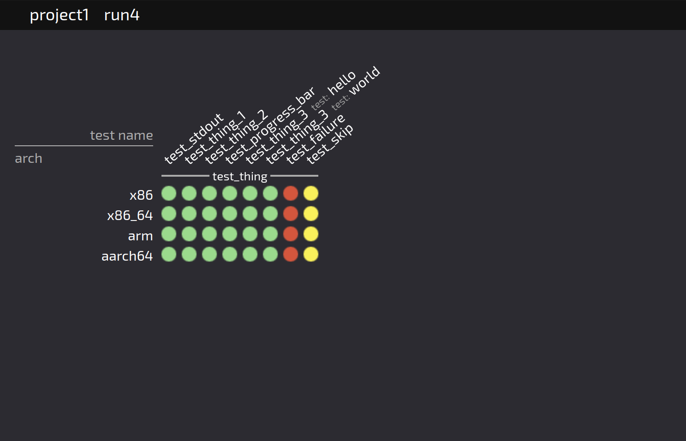

# GreenDots 🟢

A test matrix visualizer, for monitoring live pytest runs and inspecting failures in a graphical way.

It is designed to be very scalable in terms of test count (20k test cases are handled easily) and log file size (megabyte+ sized jsonl log files).

The test status updates are streamed using an append-only status log file per test worker, that is polled by the server when needed.
This eases deployment as it only requires a shared (network) drive between the test runner and the greendots server.

User documentation is limited at the moment, but here's a screenshot:



## Building

The dockerfile should build the server using `npm`, `vite`, and `go`. Internet is required during the docker build.

## Testing the server

The tests need the same generated files as a build (`go generate`, which needs the frontend built and `minify` installed, see the dockerfile):

```sh
cd greendots-server
go generate .
go test -race ./...
```

Go tests run per package, so pass `.` or `./...`, not a test file (a file is compiled alone, without the server code it tests). To run some of the tests, select them by name, e.g. `go test -race -run 'TestLogTail|TestStatusPoll' .`, or a single case with `-run 'TestLogTail/gzip/long_lines'`.

Use `-race`: without it, `TestConcurrentRequests` only catches data races that happen to crash the server, and it fails on single-CPU machines, where it can't.

`greendots-server/testdata/plugin-run` holds output recorded from the real pytest plugin. Rerun its `regenerate.sh` when the plugin's output format changes.
